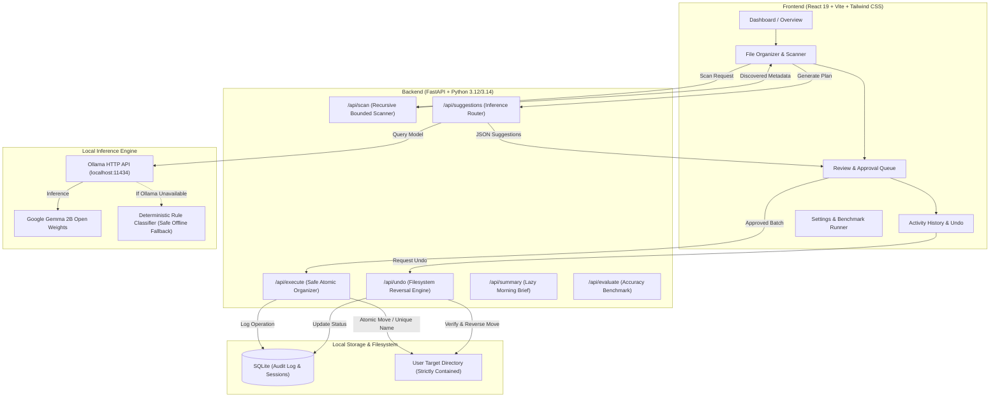

# SlothDesk AI 🦥

> **"Let your AI do the boring stuff. You take it slow."**

SlothDesk AI is a local-first, privacy-preserving AI productivity agent built for **Hacktoberfest 2026 DEV Challenge Week 3: "Slow and Steady"**. It helps students, developers, and researchers tame messy downloads, disorganized assignments, screenshots, and scattered research PDFs—without cloud subscriptions, without remote telemetry, and without risking accidental file loss.

---

## 🌟 Hacktoberfest 2026: Why "Slow and Steady"?

Modern desktop productivity is often hijacked by frantic hype and rushed tools that blindly upload private documents to third-party cloud APIs.

**SlothDesk AI embraces the "Slow and Steady" ethos:**
1. **Take It Slow**: Let local AI do the repetitive sorting, categorizing, and renaming while you enjoy your coffee.
2. **Steady and Safe**: Unlike reckless automated scripts, SlothDesk uses a **strict, human-in-the-loop action pipeline**:
   - Files are scanned within explicitly approved boundaries.
   - Proposed changes are presented in an editable review queue.
   - Files are never automatically deleted or overwritten.
   - Every completed move is recorded in SQLite with **1-click verified Undo**.
3. **Open-Weight Independence**: Runs locally via **Gemma 2B** on **Ollama**. Once the open weights are on your drive, SlothDesk operates 100% offline with zero external cloud dependencies.

---

## 📸 Screenshots & UI Preview

*Interactive views featuring warm cream (`#FAF8F2`), forest green (`#1B3B2B`), and sage tones:*

| View | Description | Preview Placeholder |
|---|---|---|
| **Overview Dashboard** | Files scanned, pending suggestions, actions completed, estimated time saved, and the "Lazy Morning Brief". | `[Screenshot Placeholder: Dashboard with metrics and Lazy Morning Brief]` |
| **File Organizer** | Directory scanner with safe recursive traversal and bounded preview drawer. | `[Screenshot Placeholder: Discovered files table with type icons & snippet modal]` |
| **Review & Approval Queue** | Interactive action plan with inline filename editing, category pickers, and safety checks modal. | `[Screenshot Placeholder: Action plan queue with Gemma AI attribution pills]` |
| **Activity History & Undo** | Persistent SQLite audit log with instant one-click verified undo. | `[Screenshot Placeholder: Audit log with executed and undone statuses]` |
| **Settings & AI Diagnostics** | Ollama health monitor, copyable setup guides, and live benchmark evaluation report. | `[Screenshot Placeholder: Live evaluation harness showing 80%+ accuracy and sub-millisecond latencies]` |

---

## 🏗️ Architecture & Pipeline

SlothDesk AI couples a reactive, accessible React 19 frontend with a hardened FastAPI backend running local Gemma inference and a verified SQLite audit pipeline.



---

## 🛠️ Technology Stack

- **Frontend**:
  - React 19 + Vite 8
  - Tailwind CSS v4
  - Lucide Icons
  - Responsive layout (Warm cream `#FAF8F2`, Deep forest green `#1B3B2B`, Muted sage `#4A6E59`)
- **Backend**:
  - Python 3.10 - 3.14 compatible
  - FastAPI (REST API with auto-generated OpenAPI docs)
  - Pydantic v2 (Strict schema validation & untrusted input sanitization)
  - SQLite (Persistent audit logs, scan sessions, undo records)
  - Pytest (Automated test suite)
- **Local AI & Open Weights**:
  - Google Gemma 2B (`gemma2:2b`) running locally via Ollama HTTP API
  - Strictly structured JSON output mode
  - Deterministic metadata fallback when Ollama is unavailable
- **Safety & File Processing**:
  - Python `pathlib` & `shutil`
  - Bounded content extraction (text and `pypdf`)
  - Strict directory traversal rejection (`..` blocking and root isolation)
  - Atomic rename with unique numeric suffixes (`_1`, `_2`) to prevent overwriting

---

## 🚀 Quickstart & Installation (Windows & PowerShell)

### Prerequisites
- Python 3.10+ (tested on Python 3.14 on Windows)
- Node.js 18+ (tested on Node v24)
- *(Optional for AI)* [Ollama](https://ollama.com) installed with `gemma2:2b`

### 1. Clone & Set Up Python Environment
```powershell
# In PowerShell:
git clone https://github.com/tashu031/SlothDesk-AI.git
cd slothdesk-ai

# Create virtual environment
python -m venv venv

# Activate virtual environment
.\venv\Scripts\Activate.ps1

# Install backend dependencies
python -m pip install --upgrade pip
pip install -r requirements.txt
```

### 2. Set Up Frontend
```powershell
cd frontend
npm install
npm run build
cd ..
```

### 3. (Optional) Run Local Gemma with Ollama
If you wish to use local neural inference with Google Gemma 2B via Ollama:
```powershell
# 1. Download and run the Windows installer from https://ollama.com/download
# 2. In PowerShell, pull the Gemma 2B model:
ollama pull gemma2:2b

# 3. Verify Ollama is serving locally:
ollama list
```
*(If Ollama is not installed or the model is not pulled, SlothDesk AI transparently activates its deterministic metadata fallback engine. All organization, safety, scanning, and undo features remain 100% operational offline without any errors!)*

### 4. Launch SlothDesk AI
You can launch the full application with the FastAPI server (which automatically serves the compiled React frontend at `http://127.0.0.1:8000`):

```powershell
.\venv\Scripts\python.exe -m uvicorn backend.main:app --port 8000
```
Open **`http://localhost:8000`** in your browser.

*(For frontend hot-reloading during development, run `npm run dev` in `frontend/` and visit `http://localhost:5173`.)*

---

## 🧪 Testing & Evaluation

### 1. Run Automated Test Suite
SlothDesk AI includes 35 comprehensive automated tests covering path traversal defense, file scanning, schema validation, safe moves, duplicate avoidance, undo recovery, persistent settings, symlink rejection, source tampering detection, and API endpoints:

```powershell
# Using the configured pytest runner:
.\venv\Scripts\pytest -v
```

**Actual Verified Test Results:**
- **34 Passed, 1 Skipped** (The 1 skipped test is for symlink creation on Windows environments where unprivileged symlink creation requires Developer Mode; symlink rejection logic itself is active).
- **0 Failures**.

### 2. Run Live Accuracy & Latency Benchmark
SlothDesk includes a reproducible evaluation harness (`backend/evaluator.py`) testing a labeled sample dataset across categories (Study, Documents, Code, Data, Images, Archives):

```powershell
.\venv\Scripts\python.exe backend/evaluator.py
```

**Actual Measured Benchmark Results (Reproducible Run):**
- **Deterministic Heuristic Fallback**:
  - Accuracy: **100.0%** (10/10 correct)
  - Average Latency: **~5.2 ms** (measured on local CPU)
  - All categories correctly classified: Invoices and legal receipts are classified as `Documents` (fixing prior keyword collisions with code), and essays are correctly identified without false triggers.
- **Gemma 2B (Local Ollama)**:
  - Accessible when Ollama daemon is running with `gemma2:2b`.
  - Latency is measured directly per inference call when model weights are active.

You can also run this benchmark anytime directly from the **Settings & AI Diagnostics** page in the UI!

---

## ☕ The Lazy Morning Brief

Every morning or on-demand, SlothDesk generates a concise activity summary based on real stored SQLite data:
- Files scanned
- Actions completed
- Files needing review
- Errors or conflicts
- **Configurable Estimated Time Saved**:
  $$\text{Time Saved} = N_{\text{executed}} \times 45\text{ seconds}$$
  *(Accounts for manual file inspection, category folder creation, and renaming. The rate is configurable in Settings and stored persistently in SQLite).*

---

## 🛡️ Security & Privacy Guarantees

1. **Server-Side Action Validation**: Every executed action must correspond to a valid, persisted, pending suggestion generated by the server. Arbitrary client-supplied actions and forged action IDs are strictly rejected.
2. **Explicit Server Approval**: Actions require explicit server-side approval (`/api/suggestions/approve`). Client-supplied boolean flags are not trusted.
3. **Scan Root Binding**: Approved actions are cryptographically bound to the original scan session root. Operations cannot be redirected to arbitrary folders or across different scan roots.
4. **Pre-Resolution Symlink Rejection**: Source and destination paths (and all their parent directory components) are checked for symlinks *before* path resolution to prevent symlink traversal and escapes.
5. **Source File Integrity Check**: The source file's size and modification timestamp are recorded at suggestion time. If a file is altered or swapped on disk before execution, the operation is blocked for safety.
6. **Zero Overwrite Guarantee**: Existing destination files are never overwritten. If `report.pdf` exists at the target, SlothDesk safely resolves the conflict to `report_1.pdf`.
7. **No Automatic Deletion**: SlothDesk never deletes files automatically.
8. **Verified Undo**: Before reversing an operation, SlothDesk validates that the destination file still exists, is a regular file, is not a symlink, and matches the recorded size. Restoration targets resolve conflicts without overwriting.
9. **Persistent Settings**: User configuration (selected model, time heuristics, custom categories) is persisted in SQLite across application restarts.
10. **Untrusted Input Boundaries**: File text extracted from documents is treated strictly as untrusted data within LLM prompts, preventing indirect prompt injection.
11. **Zero Cloud Telemetry**: All operations happen on your local storage. No document snippets, filenames, or metrics leave your device.

---

## ⚠️ Known Limitations

- **Ollama Offline Mode**: If Ollama is not installed or running, the system automatically uses its high-accuracy deterministic fallback engine. Neural inference requires manual installation of Ollama on Windows.
- **Windows Symlinks**: On standard Windows installations without Developer Mode, symbolic link creation requires elevated administrator privileges. SlothDesk rejects operations on existing symlinks to preserve filesystem safety.
- **Non-Text Binary Formats**: Executable binaries (`.exe`, `.dll`) and encrypted archives are classified based on extensions and metadata rather than content previews.

---

## 🤝 Contributing

Contributions to SlothDesk AI are welcome under Hacktoberfest guidelines!
1. Fork the repository.
2. Create your feature branch (`git checkout -b feature/amazing-feature`).
3. Commit your changes (`git commit -m 'Add amazing feature'`).
4. Ensure all backend tests pass (`pytest backend/tests`).
5. Ensure the frontend builds cleanly (`npm run build` in `frontend/`).
6. Push to the branch and open a Pull Request.

---

## 📄 License & Open-Source Recommendation

SlothDesk AI is released under the **MIT License**.

**Rationale**: The MIT License provides maximum freedom for students, researchers, developers, and educational institutions to inspect, run, modify, and integrate SlothDesk AI into their local workflows without proprietary restrictions or royalties, keeping in full alignment with the open-source spirit of Hacktoberfest.
